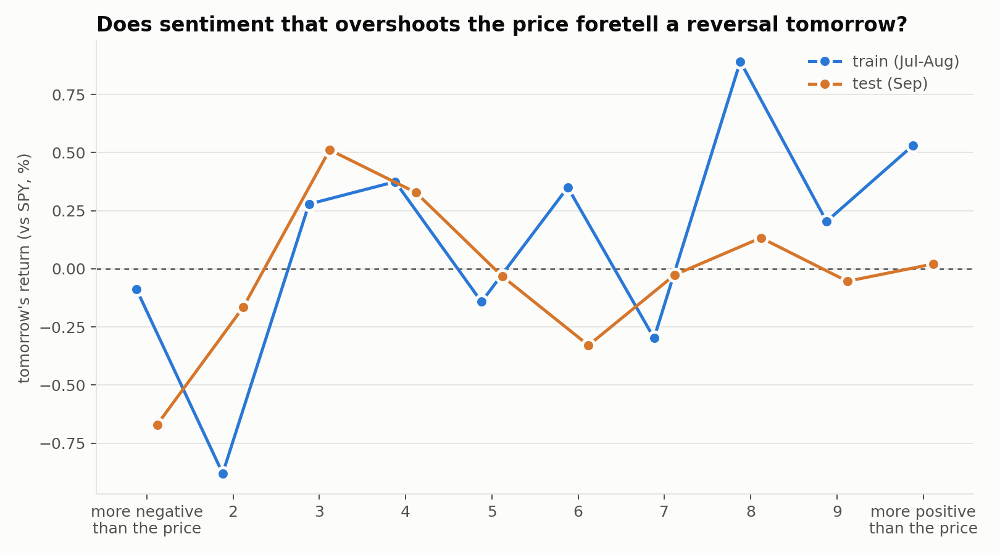
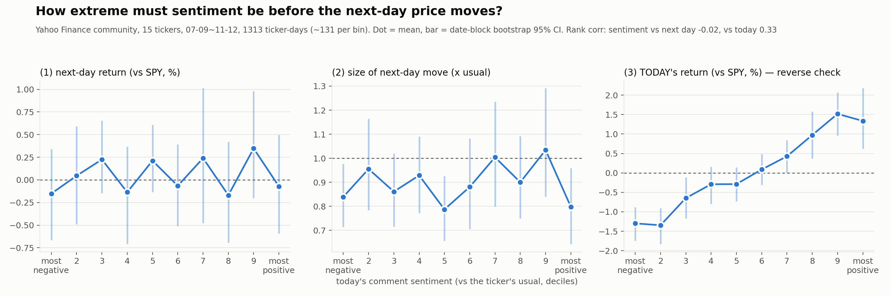

# StockMind

Do Yahoo Finance community posts tell us anything about what a stock does next?

A stock-market test of Sultan & Morstatter (2026), ["The Conversation Turns First: Crowd Discussion and Price Reversals in Prediction Markets"](https://arxiv.org/abs/2609.28965), which found that comment attention nearly matches trading history for predicting heavy trading on Polymarket.

**Short answer (Jul to mid-Nov 2026, 15 tickers, 16 experiments):** almost nothing. Comments echo what trading history already says. Sentiment follows same-day returns and does not lead next-day returns. No comment feature improved direction or volatility forecasts out of sample, and every "the crowd marks the bottom" hypothesis failed.

**One exception, and it passed a pre-registered re-test:** comments posted while the market is closed improve the forecast of a volume burst in the next morning's opening hour (PR-AUC gain +0.096, 95% CI [+0.019, +0.185], earnings nights excluded). About half of that gain is explained by the overnight price gap, and it shows up in the turbulent second half of the window only. Comments work as a news thermometer for the hours when trading history is silent. They forecast volume, not direction.

## Scorecard

| # | Question | Verdict | Key number (test window from Sep 1, through Nov 13) |
|---|---|---|---|
| 1 | Do comments predict a next-hour volume burst? | No, intraday. **Yes, overnight (pre-registered)** | trading 0.616 vs trading + comments 0.606; overnight gain +0.096 [+0.019, +0.185] |
| 2 | Does sentiment help (bursts, direction)? | No | direction ROC-AUC 0.49 to 0.50 |
| 3 | Do 30-minute blocks beat 1-hour blocks? | No | original run; cannot be re-run (see Limitations) |
| 4 | Does "excess sentiment" predict next-day direction? | No | 0.449 [0.407, 0.492]: the sign learned in Jul-Aug flipped |
| 5 | Do all 18 features predict next-day direction? | No | all 12 configurations contain 0.5 |
| 6 | Do comments improve volatility forecasts over HAR? | No | HAR 0.305 vs HAR + all 0.308 (QLIKE) |
| 7 | Do comments turn before the trend flips? | Weak pattern, no predictive gain | gain -0.008 [-0.034, +0.019] |
| 8 | Bearish tilt + heat, then a rise (NVDA)? | No | 5 of 16 signal days up vs 47% base rate |
| 9 | Is the bounce the comments or just the drop? | The drop; NVDA 5-day bounce not confirmed on sealed data | next day -0.03% [-0.64, +0.62]; NVDA 5-day re-test -3.90pp [-8.28, +3.78] |
| 10 | Is there a rage threshold that marks the bottom? | No | all three dose measures: CI contains 0 |
| 11 | Does surrender language mark the bottom? | No | top-vs-rest -0.59pp [-2.30, +0.98] |
| 12 | Accumulated rage, delayed bounce? | Not confirmed on sealed data | registered cells +1.40 / +0.53 / +0.15pp, all CIs contain 0 |
| 13 | Silence after rage? | No | global permutation p = 0.538 |
| 14 | Same as 12 on meme tickers only? | No | global permutation p = 0.260 |
| 15 | How far does trading history alone get? | Far | PR-AUC 0.155 (random) to 0.688 |
| 16 | Do days whose posts *read* alike predict tomorrow's volume? | No, beyond recency | text 0.2791 vs mean of last 3 days 0.2811 (MAE) |

## Data

| | |
|---|---|
| Posts | ~129,000 Yahoo Finance community posts, 2026-06-30 to 2026-11-13 |
| Tickers | 8 large caps (AAPL GOOG META TSLA MSFT AMZN NVDA NFLX) + 7 retail favorites (GME AMC PLTR SOFI RIVN COIN HOOD) |
| Prices | yfinance daily, 1-hour, 30-minute, and 1-minute bars (1-minute accumulated daily from 2026-09-03); earnings release times |
| Text features | Sentiment: `cardiffnlp/twitter-roberta-base-sentiment-latest`. Stance (bull / bear / neutral): FinTwitBERT. Toxicity: Detoxify `original`. Sentence embeddings: `all-MiniLM-L6-v2` |

Raw posts are not published (`community/data/` is git-ignored).

## Method

- Comments are assigned to the block that contains their timestamp; daily blocks close at 16:00 ET, so features use only information available before the target window.
- All features are relative to the ticker's own past (expanding mean, shifted one step), so NVDA and COIN share a scale.
- **Main evaluation: time split.** Train on July-August, test from September 1. The original write-up used September only (20 trading days); every experiment was re-run on 2026-11-14 with data through November 13 (52 trading days) without changing any setting. Held-out-ticker evaluation (as in the paper) is reported for reference.
- Confidence intervals: date-block bootstrap (tickers move together on the same day).
- Scans over many cells (dose x horizon) are judged by a **global permutation test** on the maximum cell, permuting dates so same-day clustering is preserved.
- Hypotheses formed after looking at data are **pre-registered** and judged only on data collected afterwards. Model settings were fixed before seeing test results; post-hoc checks are labelled as such.

## Results

### 1. Next-hour volume burst (experiments 1 to 3)

Target: the next bar's volume is above the ticker's past 80th percentile for that time of day. PR-AUC, time split.


| Features | Sep only (original) | Sep 1 to Nov 13 |
|---|---|---|
| Random | 0.142 | 0.155 |
| Comment volume | 0.349 | 0.428 |
| Trading history | **0.643** | **0.616** |
| Trading + comments | 0.642 | 0.606 |

Comments alone beat random, but everything they know is already in trading history. Adding sentiment changes nothing (-0.009 [-0.034, +0.016]). Comments beat trading history in 2 of 15 tickers (NVDA, TSLA, the two busiest boards). 30-minute blocks were no better than 1-hour blocks.

**The overnight block: a pre-registered re-test, confirmed.** In July-August, comments posted between the close and the next open improved the opening-hour forecast (+0.046); in September the effect was gone. On 2026-10-05 a re-test was registered on data collected after that date. The rule was pinned before opening ([`reruns/PREREG_overnight.md`](community/reruns/PREREG_overnight.md)): model trained before September 1 and left unchanged, overnight blocks from October 5, earnings nights excluded (an earnings date is known from the calendar, and all 13 earnings nights in the window were followed by a burst), statistic = PR-AUC(trading + comments) minus PR-AUC(trading), confirmed only if the bootstrap CI lower bound is above 0.

| Sample | Blocks | Bursts | Gain from comments | 95% CI |
|---|---|---|---|---|
| **Primary: after Oct 5, ex earnings night** | 422 | 67 | **+0.096** | [+0.019, +0.185] |
| After Oct 5, all nights | 435 | 80 | +0.154 | [+0.059, +0.261] |
| After Oct 5, ex 3 days post-earnings | 395 | 59 | +0.097 | [+0.018, +0.186] |
| Sep 1 to Oct 4, ex earnings night (seen earlier) | 344 | 68 | +0.021 | [-0.088, +0.120] |

Registered verdict: **confirmed** (trading 0.365, trading + comments 0.461, random 0.159).

Post-hoc checks, not part of the verdict:

| Check | Result | Reading |
|---|---|---|
| Leave one ticker out | +0.061 to +0.116 | not driven by one ticker |
| Add the overnight price gap to the trading features | comments add +0.053 [-0.007, +0.116]; the gap alone adds +0.100 | about half of the gain is "how far the price jumped overnight" |
| Split the window in half | before Oct 23: +0.027 [-0.058, +0.120]; from Oct 23: +0.120 [+0.022, +0.263] | concentrated in earnings season and the NVDA sell-off |

Honest reading: intraday, trading history is faster than comments. Overnight, trading history stops for 17.5 hours and comments keep moving, so they act as a proxy for overnight news. Two procedural caveats are recorded in the pre-registration file: the pass rule was written on the day of opening (the October note fixed only the data window), and a pooled all-nights number had been seen before the rule was written, which is why the stricter ex-earnings sample was made primary.

### 2. How far trading history alone gets (experiment 15)

Same target, no comments. Each step adds one kind of memory; test window Sep 1 to Nov 13.

| Step | PR-AUC | Gain over the step before |
|---|---|---|
| 0 Random | 0.155 | |
| 1 "A burst now means a burst next" | 0.460 | |
| 2 This bar's volume vs usual (logistic) | 0.637 | +0.177 [+0.153, +0.199] |
| 3 + this bar's price move | 0.627 | -0.011 [-0.022, +0.000] |
| 4 + memory (last 3 bars, today so far, the target slot yesterday) | 0.656 | +0.029 [+0.003, +0.058] |
| 5 Step 4 features, gradient boosting | **0.688** | +0.032 [+0.015, +0.048] |

Volume clusters, so its own recent past carries most of the signal. The weak spot is the overnight block (0.497 vs 0.62 to 0.75 for intraday blocks), which is exactly where comments helped in section 1.

### 3. Direction (experiments 2, 4, 5)

Next-hour or next-day return vs SPY. ROC-AUC, 0.5 = coin flip.

| Setting | Sep only (original) | Sep 1 to Nov 13 |
|---|---|---|
| Next hour, returns + comment volume + sentiment | 0.506 | 0.499 |
| Next day, "excess sentiment" (sentiment not explained by today's return) | 0.434 | 0.449 [0.407, 0.492] |
| Next day, all 18 features, logistic / gradient boosting | 0.532 / 0.543 [0.472, 0.609] | 0.524 [0.481, 0.570] / 0.489 [0.451, 0.527] |

All 12 next-day configurations of experiment 5 have 95% intervals containing 0.5. Next-hour accuracy (50.5%) is below always guessing the majority (52.3%). The excess-sentiment interval sits below 0.5, which means the relationship learned in July-August pointed the wrong way afterwards; an unstable sign is not a usable signal.



### 4. Next-day volatility (experiment 6)

Garman-Klass volatility. QLIKE, lower is better.

| Model | Sep only (original) | Sep 1 to Nov 13 | vs HAR, 95% CI |
|---|---|---|---|
| Tomorrow = today | 0.396 | 0.497 | |
| HAR (1/5/22-day) | **0.242** | **0.305** | |
| HAR + comment volume | | 0.305 | +0.0003 [-0.0069, +0.0078] |
| HAR + sentiment | | 0.309 | +0.0037 [+0.0010, +0.0065] (worse) |
| HAR + toxicity | | 0.305 | -0.0004 [-0.0014, +0.0005] |
| HAR + all comment features | 0.252 | 0.308 | +0.0031 [-0.0053, +0.0117] |

Post-hoc: removing earnings +/- 2 days from training makes HAR + comment volume slightly better than HAR (-0.0039 [-0.0073, -0.0005]). Tiny, and added after seeing results.

### 5. Sentiment follows price (descriptive)



Spearman correlation of daily sentiment (relative to the ticker's norm) with same-day excess return: **0.33** (p < 0.001); with next-day excess return: **-0.02** (p = 0.45), over 1,313 ticker-days. Reading the most extreme posts confirmed the classifier labels them correctly, so this is not a measurement artifact. People post about what the price just did.

### 6. Does the board turn before the trend flips? (experiment 7)

Trend = close above or below the 20-day moving average; a reversal = the sign changes tomorrow (163 of 1,313 ticker-days). Leader-side sentiment is slightly lower on the day before a reversal in 12 of 15 tickers (binomial p = 0.035). It does not help prediction: market state alone PR-AUC 0.399, state + sentiment 0.392, gain -0.008 [-0.034, +0.019]. Distance to the moving average already explains most reversals.

### 7. Contrarian and capitulation tests (experiments 8 to 11)

Hypothesis: when a board tilts bearish with high posting heat, the price is about to turn, and there may be a *dose* threshold ("how much rage marks the bottom?"). Stance comes from FinTwitBERT, which agreed with a hand-labelled 50-post key on 78% of bull/bear posts vs 59% for the mood-only sentiment model. Re-labelling the 3.7% lowest-confidence posts with an LLM judge changed no conclusion (daily bear share correlates 0.993 with the original).

| Test | Original (Oct 5) | Through Nov 13 |
|---|---|---|
| Bearish tilt + heat for N days, then a next-day rise (NVDA; N searched on Jul-Aug, scored from Sep 1) | N=1 chosen; 2 signal days, verdict deferred | **5 of 16 signal days up** vs 47% base rate (p = 0.94); next day -1.33%, 3 days -3.76%. Hypothesis fails |
| Same signal vs days with a *similar drop* but no signal (15 tickers, next day) | 0.00% [-0.64, +0.71] | -0.03% [-0.64, +0.62] (run of Nov 11): the signal mostly rebroadcasts the drop |
| Dose-response on falling days: toxicity / bear tilt / heat quintiles, next 5 days | rho = -0.03 / -0.14 / +0.07 | rho = +0.04 / -0.06 / +0.04; all top-vs-rest CIs contain 0 (409 falling days) |
| Dose-response with a surrender lexicon ("sold everything", "I give up", ...) | rho = -0.05; -1.29pp [-3.39, +0.72] | rho = +0.03; -0.59pp [-2.30, +0.98]; only 0.9% of posts match, so the measure is coarse |


The bear-tilt correlation that looked significant on the first run (p = 0.02, opposite to the hypothesis) faded with more data (p = 0.22).

**The NVDA 5-day bounce: pre-registered re-test, not confirmed.** A 5-day NVDA bounce after signals (+4.09% drop-matched) existed in-sample, but the hypothesis was formed from the same data, so it was registered for judgment on data collected after 2026-10-05 only. The rule was pinned before opening ([`reruns/PREREG_exp9_nvda.md`](community/reruns/PREREG_exp9_nvda.md)): NVDA days after October 5, next-5-day drop-matched difference, confirmed only if the bootstrap CI lower bound is above 0. Opened 2026-11-14: **-3.90pp [-8.28, +3.78]** on 24 days with 10 signal days (15 tickers pooled: +0.11pp [-1.65, +1.92]). Not confirmed, and the point estimate has the opposite sign. A power note written before opening said the sample was too small to confirm even a real effect (six of the ten signal days are matched against two non-signal days), so this is weak evidence against; together with experiment 8's failed confirmation, nothing supports the bounce.

### 8. Accumulated rage and a delayed bounce (experiments 12 to 14)

Hypothesis (2026-10-13): rage has to build up over several days, and the bounce comes days later. Dose = 3-day or 5-day mean toxicity vs the ticker's baseline, on falling days; outcome = cumulative excess return at each of days 1 to 10; top dose quintile vs the rest. That is a 20-cell scan, so the verdict is a global permutation test on the largest cell.

| Experiment | Result |
|---|---|
| 12, first run (Oct 13) | one borderline cell of 20 (5-day dose, day 10: +3.42pp [+0.10, +6.49]); it vanished after adding one week of data |
| 12b, global permutation | p = 0.341 on Oct 13; p = 0.277 through Nov 13. A no-effect world produces a drift this large about one time in three |
| 12, sealed confirmation on Oct 14 to Nov 9 only (opened Nov 11) | registered cells (5-day dose, days 8 / 9 / 10): +1.40 / +0.53 / +0.15pp, all CIs contain 0. **Not confirmed** |
| 13, silence after rage (quietest quintile on primed falling days) | global p = 0.778 on Oct 13; 0.538 through Nov 13. Fails |
| 14, experiment 12 on the 7 meme tickers only | global p = 0.422 on Oct 13; 0.260 through Nov 13. Fails |

On the full period through November 13 many individual cells of experiment 12 exclude 0 (top-vs-rest about +2 to +2.7pp at days 7 to 10) while the rank correlation stays near zero. The cells are cumulative horizons of the same paths, so they are one drift counted many times; the global test is the verdict, and it fails. A power note written before the sealed confirmation was opened said a miss was likely even if the effect were real, so the miss is weak evidence against. One post-hoc pattern from the confirmation window (3-day dose, short lags) is recorded as a candidate for a new seal, not as a finding.

### 9. Similar-day retrieval (experiment 16)

The analog method from load forecasting: find the past days whose posts *read* most like today's (mean sentence embedding per ticker-day, cosine similarity, same ticker, strictly earlier days) and average what happened after them. Target = log of next-day volume over its 20-day mean. Settings (k, centering) picked on days before September 15; judged once on 514 ticker-days from September 15.

| Method | MAE (lower is better) |
|---|---|
| Similar days by text (k = 10) | 0.2791 |
| Mean of the 3 most recent days, no text | 0.2811 |
| Always 0 (volume = its 20-day mean) | 0.2898 |
| Yesterday's value | 0.2942 |
| Similar days by counts only (post count, bear share) | 0.2962 |
| Past mean | 0.2965 |
| Similar days by text, neighbors from the last 10 days not allowed | 0.3020 |
| Random past days (mean of 1,000 draws) | 0.3121 |

Text beats the pre-set baselines (vs counts -0.0171 [-0.0322, -0.0021]; random p = 0.001), but the retrieved neighbors are mostly the last few days, because topics persist. Two controls added after seeing that (post-hoc, and stricter): text vs the mean of the 3 most recent days is -0.0020 [-0.0243, +0.0204], and with recent neighbors forbidden text is worse than the past mean. With the target redefined as what the 3-day mean gets wrong (`RESID=1`), text loses to predicting zero (+0.0035 [-0.0027, +0.0101]; random p = 0.11). The apparent win was volume clustering, not content. Lesson for analog forecasting in general: a similar-day method has to beat "the last few days".

## Why almost everything fails

1. **Public information.** A free, public board is priced in.
2. **Reverse causality.** Posts react to the price (same-day 0.33, next-day -0.02).
3. **Strong baselines.** Volume and volatility are well predicted by their own past (experiments 6, 15, 16), which leaves little room. The one confirmed effect sits where that baseline is blind: overnight.
4. **Wrong crowd.** Yahoo board posters are not the marginal price-setter, and restricting to meme tickers did not help.
5. **Shallow data.** Four and a half months, two earnings seasons.

## Limitations

15 tickers, four and a half months, two earnings seasons, one sharp sell-off. Earnings dates are controlled (`earnings.py` must be re-run so later seasons are included; an earlier version of `data/earnings.csv` held the July season only); other news is not. Experiment 3 cannot be re-run as written, because yfinance serves 30-minute bars for the last 60 days only and the fixed September 15 cut now leaves about one day of training; the original result stands. Hypotheses 8 to 14 are successive refinements on the same few months, so the remaining evidential weight is small even with pre-registration. Per-post LLM stance labels (used in the paper) were tried on a 3.7% slice only. Results are correlational.

## Reproduce

```bash
cd community
python3 collect.py && python3 prices.py          # posts and daily prices
uv run --no-project --with yfinance --with lxml --with pandas python earnings.py        # earnings release times
uv run --no-project --with transformers --with torch --with pandas python sentiment.py
uv run --no-project --with detoxify --with pandas python toxicity.py
python3 exp1_burst_hourly.py                      # volume bursts (also writes 1-hour bars)
python3 exp2_sentiment.py                         # sentiment: bursts and direction
python3 exp3_resolution.py                        # 1-hour vs 30-minute (see Limitations)
python3 exp4_excess_sentiment.py                  # excess sentiment -> direction
python3 exp5_all_features.py                      # direction, all features
python3 exp6_volatility.py                        # volatility vs HAR
python3 exp7_reversal.py                          # trend reversal
python3 plot_sentiment_deciles.py                 # sentiment-deciles figure
uv run --no-project --with transformers --with torch --with pandas python stance.py   # bull/bear/neutral labels
python3 exp8_contrarian.py                        # contrarian signal, N searched then confirmed
python3 exp9_drop_vs_comments.py                  # drop-matched comparison
python3 exp10_capitulation.py                     # rage dose-response on falling days
python3 exp11_surrender.py                        # surrender-lexicon dose-response
python3 exp12_accumulation.py && python3 exp12b_permutation.py   # accumulated rage, delayed bounce + global permutation
python3 exp13_silence.py                          # silence after rage
python3 exp14_meme.py                             # experiment 12 on meme tickers
python3 exp15_volume_spike.py                     # trading-only ladder for volume bursts
uv run --no-project --with sentence-transformers --with pandas python embed.py        # sentence embeddings
python3 exp16_similar_days.py                     # similar-day retrieval (RESID=1 for the residual target)
```

Outputs of the 2026-11-14 re-run are in `community/reruns/20261114/`; pre-registrations and sealed-test outputs are in `community/reruns/`. Older app code and 2025 data are in `legacy/` (unused; the earlier accuracy figures there were invalidated by look-ahead leakage).
