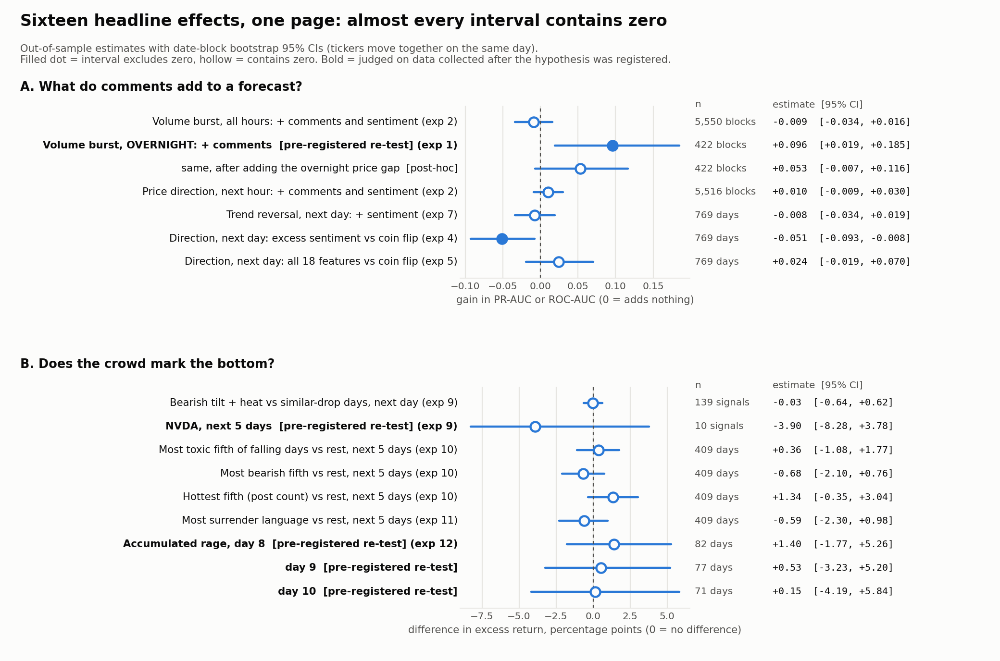
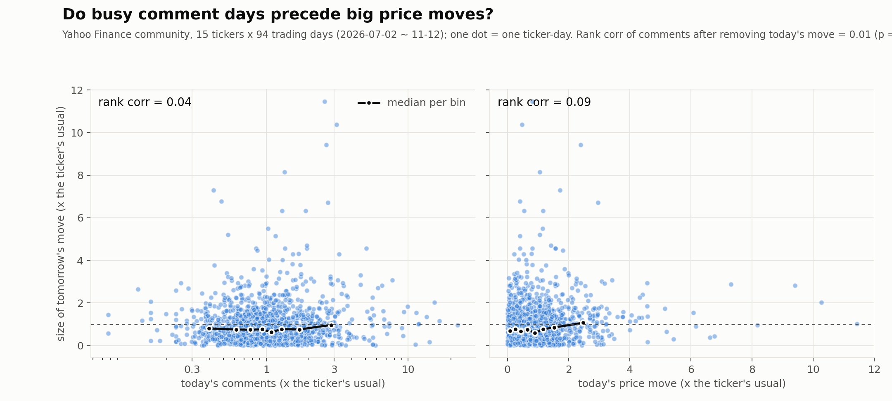
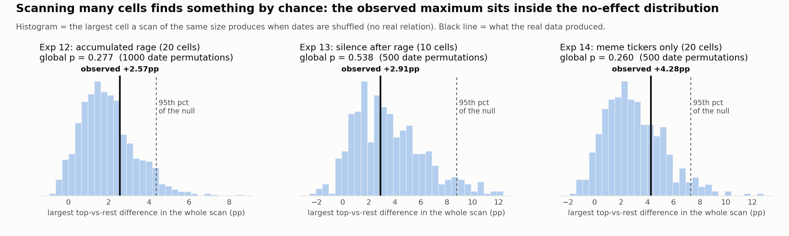
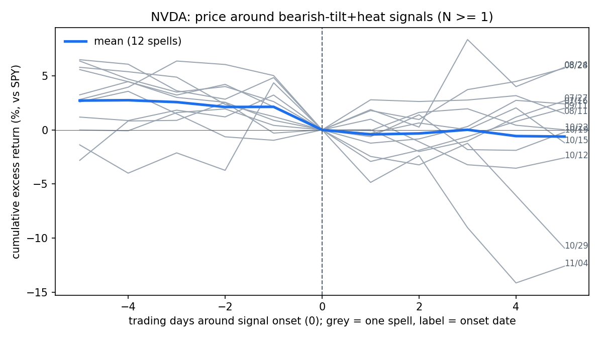

# StockMind

**Do Yahoo Finance community posts tell us anything about what a stock does next?**

A stock-market test of Sultan & Morstatter (2026), ["The Conversation Turns First"](https://arxiv.org/abs/2609.28965), which found that comment attention nearly matches trading history for predicting heavy trading on Polymarket.

**Answer: almost nothing, with one exception.** Across 16 experiments, comments add no out-of-sample information about direction, volatility, or turning points. The one effect that survived a pre-registered re-test: comments posted while the market is closed improve the forecast of a volume burst at the next open.



**How to read it.** Each row is one out-of-sample estimate with its 95% confidence interval. If the interval crosses the dashed line, the effect cannot be told apart from zero. Of 16 intervals, 2 exclude zero. With 16 tests at the 5% level, roughly one would do so by chance (the tests overlap, so this is a rough guide). One of the two is the pre-registered overnight effect. The other (experiment 4) has an unusable sign: the direction learned in training flipped in the test period.

## Study at a glance

| | |
|---|---|
| Posts | ~129,000, 2026-06-30 to 2026-11-13 |
| Tickers | 15: AAPL GOOG META TSLA MSFT AMZN NVDA NFLX, and GME AMC PLTR SOFI RIVN COIN HOOD |
| Train / test | July to August / September 1 to November 13 (52 trading days) |
| Hypotheses tested | 16 experiments |
| Pre-registered re-tests | 3 opened: **1 confirmed**, 2 not confirmed |
| Global permutation tests | 3 run: 0 passed |

Raw posts are not published (`community/data/` is git-ignored).

## Statistical design

| Element | Choice | Why |
|---|---|---|
| Leakage control | Day closes at 16:00 ET; every "usual" level is a past-only expanding mean | Features contain nothing unknown at forecast time |
| Evaluation | Time split, models and settings fixed before seeing the test window | Random splits let the future predict the past |
| Baselines | Random, persistence, trading history, HAR | A score means nothing without what you get for free |
| Uncertainty | Date-block bootstrap, 1,000 to 2,000 draws, 95% CI | Tickers move together on the same day, so rows are not independent |
| Multiplicity | Global permutation test on the maximum cell, dates permuted | A scan of 20 cells will show a "significant" cell by chance |
| Confirmation | Hypotheses formed from data are pre-registered and judged on later data only | The data that suggested a hypothesis cannot also test it |
| Metrics | PR-AUC (rare events), ROC-AUC (direction), QLIKE (volatility), MAE (volume) | Matched to the base rate and loss of each target |

## Confirmatory results (pre-registered)

These are the only results with full evidential weight. Each rule was written before the outcome was computed; the files are in [`community/reruns/`](community/reruns/).

| Hypothesis | Judged on | n | Estimate | 95% CI | Verdict |
|---|---|---|---|---|---|
| Overnight comments improve the opening-hour volume-burst forecast (exp 1) | Oct 5 to Nov 12, earnings nights excluded | 422 blocks, 67 bursts | PR-AUC gain **+0.096** | [+0.019, +0.185] | **Confirmed** |
| NVDA bounces over 5 days after a bearish-tilt signal, beyond similar-drop days (exp 9) | Oct 6 to Nov 6 | 24 days, 10 signals | -3.90 pp | [-8.28, +3.78] | Not confirmed |
| Accumulated rage is followed by a bounce at days 8 to 10 (exp 12) | Oct 14 to Nov 9 | 82 / 77 / 71 days | +1.40 / +0.53 / +0.15 pp | all contain 0 | Not confirmed |

**The confirmed effect, tested harder (post-hoc, not part of the verdict):**

| Check | Result | Reading |
|---|---|---|
| Leave one ticker out | gain stays +0.061 to +0.116 | Not driven by one ticker |
| Add the overnight price gap to the baseline | comments add +0.053 [-0.007, +0.116] | About half the gain is "how far the price jumped overnight" |
| Split the window in half | first half +0.027 [-0.058, +0.120], second half +0.120 [+0.022, +0.263] | Concentrated in earnings season and the NVDA sell-off |

Reading: intraday, trading history is faster than comments. Overnight, trading history is silent for 17.5 hours and comments keep moving, so they work as a news thermometer. They forecast volume, not direction.

<details>
<summary>Procedural caveats for the overnight test</summary>

The October registration fixed only the data window. The pass rule (statistic, earnings handling, threshold) was written on the day of opening, and a pooled all-nights number had been seen before that. This is why the stricter earnings-excluded sample was made primary. All 13 earnings nights in the window were followed by a burst, which a calendar would predict without any comments. Secondary samples: all nights +0.154 [+0.059, +0.261]; excluding 3 days after earnings +0.097 [+0.018, +0.186]; the earlier window (Sep 1 to Oct 4) +0.021 [-0.088, +0.120].

</details>

## Exploratory results

### 1. Volume bursts: comments echo trading history (exp 1 to 3, 15)

Target: next-hour volume above the ticker's past 80th percentile for that time of day (base rate 0.155). PR-AUC on the test window.

| Features | PR-AUC |
|---|---|
| Random | 0.155 |
| Comment volume only | 0.428 |
| Trading history only | **0.616** |
| Trading + comments | 0.606 |
| Trading + comments + sentiment | 0.607 |

Gain from comments and sentiment: -0.009 [-0.034, +0.016]. Trading history alone, built up step by step (exp 15):

| Step | PR-AUC | Gain over previous step, 95% CI |
|---|---|---|
| "A burst now means a burst next" | 0.460 | |
| This bar's volume vs usual | 0.637 | +0.177 [+0.153, +0.199] |
| + this bar's price move | 0.627 | -0.011 [-0.022, +0.000] |
| + memory (last 3 bars, today so far, same slot yesterday) | 0.656 | +0.029 [+0.003, +0.058] |
| Same features, gradient boosting | **0.688** | +0.032 [+0.015, +0.048] |

The weak spot of trading history is the overnight block (0.497, vs 0.62 to 0.75 intraday), the same place where comments helped.



### 2. Direction: a coin flip (exp 2, 4, 5)

ROC-AUC, 0.5 = coin flip.

| Setting | ROC-AUC | 95% CI |
|---|---|---|
| Next hour, trading + comments + sentiment | 0.499 | gain +0.010 [-0.009, +0.030] |
| Next day, excess sentiment | 0.449 | [0.407, 0.492] |
| Next day, all 18 features, logistic | 0.524 | [0.481, 0.570] |
| Next day, all 18 features, gradient boosting | 0.489 | [0.451, 0.527] |

All 12 configurations of experiment 5 contain 0.5. Next-hour accuracy (50.5%) is below always guessing the majority (52.3%).

### 3. Volatility: HAR needs no help (exp 6)

Garman-Klass volatility, QLIKE (lower is better).

| Model | QLIKE | Difference vs HAR, 95% CI |
|---|---|---|
| Tomorrow = today | 0.497 | |
| HAR (1 / 5 / 22-day) | **0.305** | |
| HAR + comment volume | 0.305 | +0.0003 [-0.0069, +0.0078] |
| HAR + sentiment | 0.309 | +0.0037 [+0.0010, +0.0065] |
| HAR + toxicity | 0.305 | -0.0004 [-0.0014, +0.0005] |
| HAR + all comment features | 0.308 | +0.0031 [-0.0053, +0.0117] |

### 4. Sentiment follows price (descriptive)

Spearman rank correlation of daily sentiment with excess return, 1,313 ticker-days:

| | rho | p |
|---|---|---|
| Same day | **+0.33** | < 0.001 |
| Next day | -0.02 | 0.45 |

People post about what the price just did. This one fact explains most of the null results above.


### 5. Does the crowd mark the bottom? No (exp 7 to 14)

Top-vs-rest differences in next-5-day excess return on falling days, in percentage points (panel B of the figure above):

| Dose measure | n | Spearman rho (p) | Top fifth minus rest | 95% CI |
|---|---|---|---|---|
| Toxicity (exp 10) | 409 | +0.04 (0.46) | +0.36 | [-1.08, +1.77] |
| Bear tilt (exp 10) | 409 | -0.06 (0.22) | -0.68 | [-2.10, +0.76] |
| Post count (exp 10) | 409 | +0.04 (0.39) | +1.34 | [-0.35, +3.04] |
| Surrender language (exp 11) | 409 | +0.03 (0.54) | -0.59 | [-2.30, +0.98] |

Other tests in this family:

| Test | Result |
|---|---|
| NVDA: bearish tilt + heat, then a next-day rise (exp 8; N chosen on Jul-Aug, scored from Sep 1) | 5 of 16 signal days up vs a 47% base rate, one-sided binomial p = 0.94 |
| Same signal vs similar-drop days, 15 tickers, next day (exp 9) | -0.03 pp [-0.64, +0.62]: the signal rebroadcasts the drop |
| Sentiment turns before a trend reversal (exp 7) | 12 of 15 tickers show the pattern (binomial p = 0.035), but prediction gain is -0.008 [-0.034, +0.019] |

**Scans over dose and horizon (exp 12 to 14).** These test up to 20 cells each, so single-cell intervals are not evidence. The verdict is a permutation test on the largest cell:



| Scan | Cells | Observed max | Null median / 95th pct | Global p |
|---|---|---|---|---|
| Accumulated rage (exp 12) | 20 | +2.57 pp | +1.79 / +4.37 pp | 0.277 |
| Silence after rage (exp 13) | 10 | +2.91 pp | | 0.538 |
| Accumulated rage, meme tickers only (exp 14) | 20 | +4.28 pp | | 0.260 |

<details>
<summary>Details: experiment 12 cell-level pattern, stance labels</summary>

On the full period many individual cells of experiment 12 exclude zero (about +2 to +2.7 pp at days 7 to 10) while the rank correlation stays near zero. The cells are cumulative horizons of the same price paths, so they are one drift counted many times; the global test and the sealed confirmation are the verdicts, and both fail. A power note written before the sealed confirmation was opened said a miss was likely even if the effect were real, so the miss is weak evidence against.

Stance (bull / bear / neutral) comes from FinTwitBERT, which agreed with a hand-labelled 50-post key on 78% of bull/bear posts vs 59% for the mood-only sentiment model. Re-labelling the 3.7% lowest-confidence posts with an LLM judge changed no conclusion: the daily bear share correlates 0.993 with the original ([`RESULT_stance_v3.md`](community/reruns/RESULT_stance_v3.md)).

The bear-tilt correlation that looked significant on the first run (rho = -0.14, p = 0.02, n = 259) faded with more data (rho = -0.06, p = 0.22, n = 409).



</details>

### 6. Similar-day retrieval: recency, not content (exp 16)

The analog method from load forecasting: find past days whose posts read most like today's (mean sentence embedding, cosine similarity, same ticker, earlier days only) and average what followed. Target: log of next-day volume over its 20-day mean. 514 test ticker-days, MAE (lower is better).

| Method | MAE |
|---|---|
| Similar days by text (k = 10) | 0.2791 |
| Mean of the 3 most recent days, no text | 0.2811 |
| Yesterday's value | 0.2942 |
| Similar days by counts only | 0.2962 |
| Past mean | 0.2965 |
| Similar days by text, last 10 days excluded | 0.3020 |
| Random past days | 0.3121 |

| Comparison | Difference | 95% CI | |
|---|---|---|---|
| Text vs counts (pre-set) | -0.0171 | [-0.0322, -0.0021] | passes |
| Text vs random past days (pre-set) | | p = 0.001 (1,000 random draws) | passes |
| Text vs 3 most recent days (post-hoc) | -0.0020 | [-0.0243, +0.0204] | no difference |
| Text on the residual of the 3-day mean (post-hoc) | +0.0035 | [-0.0027, +0.0101] | no gain |

The retrieved neighbors are mostly the last few days, because topics persist. The apparent win was volume clustering. A similar-day method has to beat "the last few days".

## Why almost everything fails

1. **Public information.** A free, public board is already in the price.
2. **Reverse causality.** Posts react to the price (same day +0.33, next day -0.02).
3. **Strong baselines.** Volume and volatility are well predicted by their own past, which leaves little room. The one confirmed effect sits where that baseline is blind: overnight.
4. **Wrong crowd.** Yahoo board posters are not the marginal price-setter; restricting to meme tickers did not help.
5. **Shallow data.** Four and a half months, two earnings seasons.

## Limitations

- 15 tickers, four and a half months, two earnings seasons, one sharp sell-off.
- Earnings dates are controlled; other news is not.
- Hypotheses 8 to 14 are successive refinements on the same few months, so their combined evidential weight is small even with pre-registration.
- Experiment 3 (30-minute vs 1-hour blocks: no improvement) cannot be re-run, because yfinance serves 30-minute bars for the last 60 days only. The original result stands.
- Per-post LLM stance labels (used in the paper) were tried on a 3.7% slice only.
- All results are correlational.

<details>
<summary>What changed between the original write-up (September only) and the full re-run</summary>

Every experiment was re-run on 2026-11-14 with data through November 13, without changing any setting. The test window grew from 20 to 52 trading days.

| Result | Sep only | Sep 1 to Nov 13 |
|---|---|---|
| Volume burst: trading / trading + comments | 0.643 / 0.642 | 0.616 / 0.606 |
| Direction, excess sentiment | 0.434 | 0.449 [0.407, 0.492] |
| Direction, all features, logistic / boosting | 0.532 / 0.543 | 0.524 / 0.489 |
| Volatility: HAR / HAR + all | 0.242 / 0.252 | 0.305 / 0.308 |
| Sentiment vs same-day / next-day return | 0.32 / -0.01 | 0.33 / -0.02 |
| NVDA contrarian signal (exp 8) | 2 signal days, deferred | 5 of 16 up, fails |
| Rage dose-response rho (toxicity / bear / heat) | -0.03 / -0.14 / +0.07 | +0.04 / -0.06 / +0.04 |

No conclusion changed. An earlier version of `data/earnings.csv` held the July season only; `earnings.py` now keeps every release in the window.

</details>

<details>
<summary>Reproduce</summary>

```bash
cd community
python3 collect.py && python3 prices.py          # posts and daily prices
uv run --no-project --with yfinance --with lxml --with pandas python earnings.py        # earnings release times
uv run --no-project --with transformers --with torch --with pandas python sentiment.py
uv run --no-project --with detoxify --with pandas python toxicity.py
uv run --no-project --with transformers --with torch --with pandas python stance.py   # bull/bear/neutral labels
python3 exp1_burst_hourly.py                      # volume bursts (also writes 1-hour bars)
python3 exp2_sentiment.py                         # sentiment: bursts and direction
python3 exp3_resolution.py                        # 1-hour vs 30-minute (see Limitations)
python3 exp4_excess_sentiment.py                  # excess sentiment -> direction
python3 exp5_all_features.py                      # direction, all features
python3 exp6_volatility.py                        # volatility vs HAR
python3 exp7_reversal.py                          # trend reversal
python3 exp8_contrarian.py                        # contrarian signal, N searched then confirmed
python3 exp9_drop_vs_comments.py                  # drop-matched comparison
python3 exp10_capitulation.py                     # rage dose-response on falling days
python3 exp11_surrender.py                        # surrender-lexicon dose-response
python3 exp12_accumulation.py && python3 exp12b_permutation.py   # accumulated rage + global permutation
python3 exp13_silence.py                          # silence after rage
python3 exp14_meme.py                             # experiment 12 on meme tickers
python3 exp15_volume_spike.py                     # trading-only ladder for volume bursts
uv run --no-project --with sentence-transformers --with pandas python embed.py        # sentence embeddings
python3 exp16_similar_days.py                     # similar-day retrieval (RESID=1 for the residual target)
python3 plot_sentiment_deciles.py && python3 plot_comments_vs_move.py && python3 plot_summary.py   # figures
```

Outputs of the 2026-11-14 re-run are in `community/reruns/20261114/`; pre-registrations and sealed-test outputs are in `community/reruns/`. Older app code and 2025 data are in `legacy/` (unused; the earlier accuracy figures there were invalidated by look-ahead leakage).

</details>
